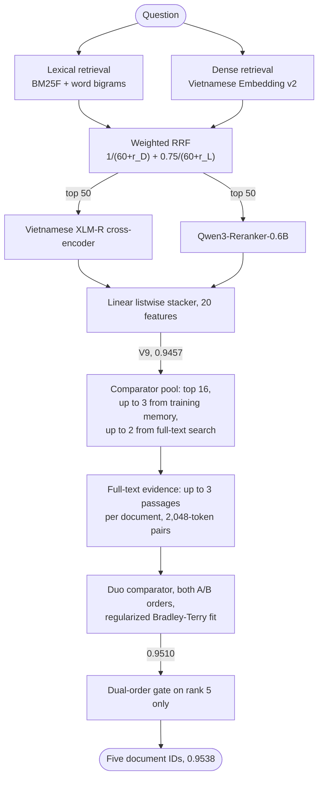

<div align="center">

<picture>
  <source media="(prefers-color-scheme: dark)" srcset="banner.svg">
  
</picture>

# Vietnamese legal information retrieval

Our system for Task 1 (LegalIR) of the UIT Data Science Challenge 2026.<br>
**4th place in Task 1**, with a private-test Recall@5 of 0.9538.

[Paper (PDF)](main.pdf) · [Results](#results) · [How it works](#how-it-works) · [Repository layout](#repository-layout) · [Running the code](#running-the-code)

</div>

## The task

The UIT Data Science Challenge is run by the University of Information Technology (UIT), VNU-HCM. In Task 1, each input is a Vietnamese legal question. A system must return the IDs of the documents, out of a corpus of 8,532 legal and administrative texts, that contain the information needed to answer it.

```json
{ "86666": { "question": "Thời hạn cấp đăng ký xe máy của người nước ngoài làm việc tại Việt Nam là bao lâu?" } }
```

```json
{ "86666": { "answer": ["280282", "...", "...", "...", "..."] } }
```

| File | Size | Labels | Used for |
| --- | ---: | --- | --- |
| `train.json` | 7,000 questions | yes | Training. 6,447 questions have one gold document; 3,105 distinct documents appear as answers. |
| `public-official.json` | 1,000 questions | released later for 998 | Public leaderboard |
| `private-official.json` | 2,080 questions | no | Final private leaderboard |
| `selected-contexts.zip` | 8,532 documents | | Corpus: one `context_*.json` per document, with `id`, `name`, `link` and `passage` |

Teams are ranked by recall, with precision as the tie-breaker. Both are averaged over questions:

$$
\text{Recall} = \frac{1}{N}\sum_{q=1}^{N}\frac{|A_q \cap G_q|}{|G_q|}
\qquad
\text{Precision} = \frac{1}{N}\sum_{q=1}^{N}\frac{|A_q \cap G_q|}{|A_q|}
$$

A question with no predicted IDs, or with more than five, scores zero. Order inside the five does not count, so returning exactly five documents is always at least as good for the ranking. A submission is a `submission.zip` holding only `submission.json`; the official scorer is in [`tools/scoring/scoring.py`](tools/scoring/scoring.py). Systems may use at most 4B model parameters in total, only models from the organizers' approved list (see [`docs/reference/`](docs/reference)), and no external APIs.

## Results

We finished 4th in Task 1. Our best private score was 0.9538 Recall@5 on the 2,080 private questions.

The table lists the private submissions reported in Table 3 of the paper, in the order we made them; a few other scored attempts are left out. Private labels were never released, so each number is leaderboard feedback on a policy we picked partly because of earlier feedback. We made at least 16 scored private submissions in total.

| # | System | Private Recall@5 | Kept? |
| --: | --- | ---: | --- |
| 1 | V9: two pointwise rerankers and a 20-feature stacker | 0.9457 | baseline |
| 2 | Duo pairwise comparator on short passages | 0.9469 | yes |
| 3 | Duo with query-focused full-text evidence | 0.9510 | yes, used as the ranking anchor |
| 4 | Deeper candidate pool (top 100), fusion fitted on 256 questions | 0.9464 | no |
| 5 | Same, fitted on 512 questions | 0.9459 | no |
| 6 | Fifth-slot agreement rule, threshold 0.98 | 0.9525 | yes |
| 7 | Fifth-slot agreement rule, threshold 0.97 | 0.9533 | yes |
| 8 | Passages reordered by pointwise score for every question | 0.9529 | no |
| 9 | **Dual-order fifth-slot gate (final)** | **0.9538** | **final submission** |
| 10 | Dual-order gate, threshold 0.95 | 0.9533 | no |

<details>
<summary>Public-phase versions</summary>

| Version | Change | Validation | Public |
| --- | --- | ---: | ---: |
| v0 | Lexical retrieval only | 0.8483 | |
| v1 | Dense and lexical fusion, tuned | | 0.9223 |
| v2 | Cross-encoder reranker | | 0.9433 |
| v4 | 12-feature learned stacker | 0.9454 | 0.9493 |
| v9 | Two rerankers, 20-feature stacker | 0.9464 | 0.9508 |
| v10 | Out-of-fold stacker weights | | 0.9464 |
| v11 | 2,048-token bundled evidence as a stacker feature | 0.9463 | 0.9498 |
| v12 | 1.88B reranker in place of the 0.57B one | 0.9444 | 0.9449 |

V9 was 9th on the public board when we submitted it. [`docs/state/SUMMARY.md`](docs/state/SUMMARY.md) has the details.

</details>

## How it works



**Retrieval.** Documents are split into 341,401 article and clause chunks. A fielded BM25F index with word-bigram features and a dense bi-encoder each rank the chunks. Results are grouped by document and combined with weighted reciprocal-rank fusion; a channel only contributes to a document it actually returned.

**Pointwise reranking (V9).** Two rerankers score the top 50 documents, using up to three passages and 768 tokens per document. A linear stacker, trained with a listwise loss that allows several gold documents per question, combines 20 features normalized within each question: five passage-score summaries per reranker (max, second, mean, spread, near-top count), seven retrieval features and three agreement features between the rerankers.

**Full-text evidence.** Article chunking misses text near odd headings, tables and annexes, so we also keep a SQLite FTS index over full document bodies, in 220-token windows with 64 tokens of overlap. It can add up to two candidates to the comparator pool; a document needs a contiguous match of at least six tokens and query-term coverage of at least 0.55. The same index picks up to three passages per document for the comparator, skipping any passage with Jaccard similarity above 0.8 to one already chosen.

**Pairwise comparison.** A Qwen comparator reads the question and two documents within 2,048 tokens. We score each pair in both orders and average:

$$P_{ij} = \tfrac12\big[p(i \mid i,j) + 1 - p(j \mid j,i)\big]$$

A Bradley-Terry fit, regularized toward the stacker score $\pi$, gives each document an ability $\hat\gamma$. Documents are ranked by $0.75\,\pi + 0.25\,\hat\gamma$.

**Fifth-slot gate.** We have two comparator checkpoints (the original and a retrained one) and run each on two passage orders: the saved lexical order and an order sorted by pointwise score. A document $c$ outside the current five may replace the fifth document $v$ if all of these hold:

$$u(c) = \min_m P^{m,1}_{cv} \ge 0.97,\qquad b(c) = \min_m P^{m,0}_{cv} > 0.5,\qquad h(c) = \min_{m,o}\big(\gamma^{m,o}_c - \gamma^{m,o}_v\big) > 0$$

Ranks 1 to 4 never change. With one swap per question, aggregate recall can move by at most $|S|/N$, where $S$ is the set of changed questions. That caps the size of the effect; it says nothing about its sign.

### Models

All checkpoints are on the organizers' approved list. Training and inference used BF16 with no quantization, on rented H100 and RTX 4090 GPUs.

| Component | Checkpoint | Parameters |
| --- | --- | ---: |
| Dense encoder | [`AITeamVN/Vietnamese_Embedding_v2`](https://huggingface.co/AITeamVN/Vietnamese_Embedding_v2) | 567.8M |
| Pointwise reranker 1 | [`AITeamVN/Vietnamese_Reranker`](https://huggingface.co/AITeamVN/Vietnamese_Reranker), fine-tuned with group size 32 | 567.8M |
| Pointwise reranker 2 | [`Qwen/Qwen3-Reranker-0.6B`](https://huggingface.co/Qwen/Qwen3-Reranker-0.6B) | 595.8M |
| Duo comparator | Qwen3-Reranker-0.6B with LoRA | 595.8M |
| Retrained Duo comparator | Qwen3-Reranker-0.6B with LoRA | 595.8M |
| Total | | 2,922.8M (73.1% of the 4B limit) |

## What we found

The paper, *When More Reranking Is Not Better: Evidence-Order Stability for Vietnamese Legal Retrieval* ([`main.pdf`](main.pdf)), covers this in detail.

More candidates did not mean more correct answers. Enlarging the comparator pool raised gold coverage on our 429-question development set by 0.0105, and the deeper-pool runs scored slightly higher on development. On the private test they dropped to 0.9464 and 0.9459, below the 0.9510 anchor. A larger pool also brings more documents that can push a correct answer out of the top five.

Recall@5 hides most ranking changes. Reordering the passages a comparator already sees changed 95 of 429 development answer sets and left recall the same on every one. Applied to all private questions, it changed 500 of 2,080 sets (24.0%). The fifth-slot gate changed 43 (2.1%) and kept ranks 1 to 4 fixed.

The labels miss a lot. On the 998 public questions labeled after the competition, a pairwise reranker changed 453 answer sets, but recall moved on only 8 (3 better, 5 worse). 247 public gold documents never appear as an answer in the training set, so a system that only predicts training answers could reach at most 0.763.

Things that did not help:

| Idea | Result |
| --- | --- |
| Better embedder | Candidate recall@5 up 0.0257, final recall down 0.0006 |
| Out-of-fold stacker weights (v10) | Public down 0.0044 |
| Bundled 2,048-token evidence as a stacker feature (v11) | 55 answer sets changed, recall unchanged on all of them |
| Reranker 3.3 times larger (v12) | Public down 0.0059 |
| Deeper pool with a 23-feature learned prior | Private down 0.0046 and 0.0051 |
| Retrained full-text comparator on its own | 0.9500 private, down 0.0010 |
| Focused and citation rescue, FTS threshold sweeps, candidates from cited documents | Coverage gains under the +0.008 we required before spending a private submission |

The V9 improvement itself came from a bug fix. The stacker had been reading only the first reranker's scores, so the second reranker was computed and then ignored.

## Repository layout

```text
legalir2/          current pipeline
  store.py, structure.py              corpus loading, article/clause chunking, SQLite store
  lexical.py, dense.py, fuse.py       BM25F + bigrams, dense retrieval, weighted RRF
  rerank.py, stack.py, train_ce.py    pointwise rerankers and the stacker
  duo.py, duo_evidence.py             pairwise comparator, full-text evidence, tournament
  duo_agreement.py, passage_*.py      agreement rule, passage order, fifth-slot gate
  private_infer.py, h100.py           private-test inference with hash checks on frozen models
legalir/           first version of the pipeline
tests/, tests2/    tests for legalir and legalir2
scripts/
  analysis/        CPU audits and submission builders
  gpu/             GPU launchers and helpers
  package/         release builders that verify file hashes
config/            pinned dependencies
data/              train, public and private question files
tools/scoring/     official scorer
docs/              development notes, runbooks, history, organizer documents
main.pdf           the paper
```

Model weights, indexes, caches, submissions, releases and the `*.sh` launchers are listed in `.gitignore`, so a clone of this repository does not have what the GPU pipeline needs to run. Those files are kept in separate release packages. Never commit `*.conf` files or `.secrets/`.

## Running the code

The pipeline is pinned to `torch==2.7.1+cu128` and `transformers==4.51.3`.

```bash
python -m venv .venv
source .venv/bin/activate            # Windows: .venv\Scripts\activate
pip install -r config/requirements-private-h100.txt
```

Put the organizer's question files in `data/` and unzip the corpus into `data/selected-contexts/`. The `legalir2` command line covers building the store and indexes, caching scores, fitting the stacker, prediction and packaging:

```bash
python -m legalir2 --help
python -m unittest discover -s tests2 -t .
```

[`tools/scoring/scoring.py`](tools/scoring/scoring.py) scores a submission against labeled data and expects the organizer's `/app/input/{ref,res}` layout. For full GPU runs, start with [`docs/runbooks/RUNBOOK-private.md`](docs/runbooks/RUNBOOK-private.md) and the [Docker handoff runbook](docs/runbooks/RUNBOOK-best-09523-handoff.md).

## Documentation

| File | Contents |
| --- | --- |
| [`docs/development/README.md`](docs/development/README.md) | Developer handoff and best artifacts |
| [`docs/development/PIPELINE.md`](docs/development/PIPELINE.md) | Retrieval, evidence, Duo, data splits, coding conventions |
| [`docs/development/EXPERIMENT-RESULTS.md`](docs/development/EXPERIMENT-RESULTS.md) | Score ledger and analysis of changed answers |
| [`docs/development/PASSAGE-COMBINATION.md`](docs/development/PASSAGE-COMBINATION.md) | The final fifth-slot policy |
| [`docs/development/DUO-AGREEMENT-CPU.md`](docs/development/DUO-AGREEMENT-CPU.md) | The agreement rule with two comparators |
| [`docs/state/PRIVATE-TEST.md`](docs/state/PRIVATE-TEST.md) | Private-test history |
| [`docs/state/SUMMARY.md`](docs/state/SUMMARY.md) | Public-phase system and versions v0 to v12 |
| [`docs/runbooks/`](docs/runbooks) | GPU, packaging and recovery instructions |
| [`docs/history/`](docs/history) | Older plans and postmortems |
| [`docs/PROJECT-LAYOUT.md`](docs/PROJECT-LAYOUT.md) | Local and cloud directory map |

## Citation

```bibtex
@misc{dsc2026legalir,
  title  = {When More Reranking Is Not Better: Evidence-Order Stability for Vietnamese Legal Retrieval},
  author = {Anonymous},
  year   = {2026},
  note   = {UIT Data Science Challenge 2026, Task 1 (LegalIR)}
}
```

## Acknowledgements

Thanks to UIT, VNU-HCM for organizing the [Data Science Challenge 2026](https://dsc.uit.edu.vn) and releasing the LegalIR data. The system uses open checkpoints from AITeamVN and Qwen, and builds on reciprocal rank fusion (Cormack et al., 2009), mono/duo ranking (Pradeep et al., 2021) and the Bradley-Terry model (Bradley and Terry, 1952).
